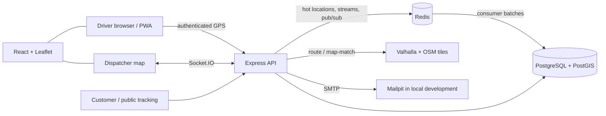

# RouteCommand

RouteCommand is a logistics operations prototype for dispatching shipments, tracking a fleet, and guiding drivers through pickup and delivery. Its core is a spatial and real-time data pipeline: browser GPS fixes are validated and buffered in Redis, persisted to PostGIS in batches, and shared with authorized maps over Socket.IO.

> **Project status:** Phases 0–13 are recorded as complete in [the progress log](docs/PROGRESS.md). Phases 14, 14A, and 15–20 remain open. Phase 21 documentation is being prepared early at the user's request; this is not a production-readiness claim. Navigation has recently been implemented but still needs its planned device and integration review.

## What is in the repository

- Dispatcher and admin workspaces for fleet, vehicles, shipments, zones, alerts, email, and security.
- A driver workspace with GPS sharing, offline queues, shipment actions, map, and turn-by-turn navigation.
- Customer dashboard and privacy-filtered public shipment tracking.
- PostgreSQL 16 + PostGIS, Redis, Mailpit, and Valhalla routing in local Compose.
- API reference at `/docs/` and `/openapi.json` while the API is running.

## Requirements

- Docker Engine with the Compose plugin.
- Node.js 26 and npm 11 for host development or running repository scripts.
- Local GeoLite2 City data for IP lookup, if that feature is being used. The `.mmdb` file is not committed.
- A Valhalla OSM tile extract under `apps/routing/data/` for road routing. See [routing setup](docs/ROUTING.md); this dataset is large and is not committed.

## Local setup

From the repository root:

```sh
npm ci
docker compose up -d --build
docker compose exec -T api npm run db:migrate --workspace @routecommand/api
docker compose exec -T api npm run db:seed --workspace @routecommand/api
```

The Compose override starts the API, web app, and Valhalla with the infrastructure services. Wait for the services to settle, then open:

- Web app: <http://localhost:5173>
- API health: <http://localhost:3000/health>
- API docs: <http://localhost:3000/docs/>
- Mailpit: <http://localhost:8025>

Without local GeoLite2 or Valhalla data, those integrations may be unavailable; core app startup does not provision these datasets. Follow [GeoIP provisioning](docs/GEOIP.md) and [routing setup](docs/ROUTING.md) when needed. For a host-run API/web workflow, start only the base services with `docker compose -f docker-compose.yml up -d`, then use `npm run dev` in another terminal.

### Demo accounts

After running the development seed, the local-only password for each account is `RouteCommandDemo!2026`:

| Role       | Email                             |
| ---------- | --------------------------------- |
| Admin      | `admin@routecommand.local`        |
| Dispatcher | `amara.okafor@routecommand.local` |
| Driver     | `driver01@routecommand.local`     |
| Customer   | `customer01@routecommand.local`   |

These seeded credentials are public development fixtures. Never use them for a deployed or shared environment. The seed command resets selected demo records to known values; review `apps/api/src/db/seed.ts` and `apps/api/db/seed.sql` before running it against any non-disposable database.

## Architecture



See [the architecture and sequence diagrams](docs/ARCHITECTURE.md) for module boundaries and request flows.

## Useful commands

```sh
npm run dev                 # host API and web; start base services separately
npm run build
npm run lint
npm run typecheck
npm run test
npm run test:integration    # needs Testcontainers/Docker or configured disposable services
npm run db:migrate
npm run db:seed             # local development data only
```

For the bounded telemetry simulator, obtain a driver access token, then run `TELEMETRY_TOKEN=<driver-access-token> npm run sim -- --count=10000`. The token is a secret: do not paste it into logs or commit it. See [telemetry docs](docs/TELEMETRY.md).

## Demo and verification

The current walkthrough and its known prerequisites are in [docs/DEMO_SCRIPT.md](docs/DEMO_SCRIPT.md). It describes available screens and backend behavior without implying that unfinished phases have passed. Browser screenshots/video, a fresh-clone timed run, and the still-open Phase 14–20 validation work remain to be completed before the Phase 21 definition of done can be claimed.

## Documentation

- [Progress and phase status](docs/PROGRESS.md)
- [Architecture](docs/ARCHITECTURE.md)
- [API reference](docs/API.md)
- [Security model and remaining verification](docs/SECURITY.md)
- [Performance evidence and open measurements](docs/PERFORMANCE.md)
- [Demo walkthrough](docs/DEMO_SCRIPT.md)
- [Interview walkthrough and package/map explanations](docs/INTERVIEW_GUIDE.md)
- [All project guides](docs/)
