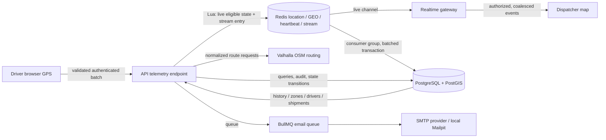
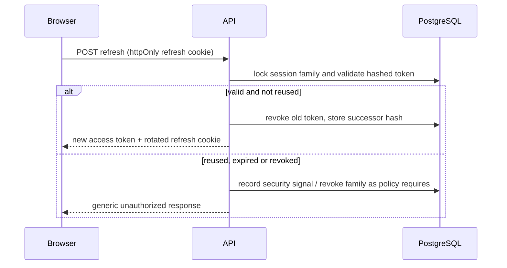

# Architecture

RouteCommand is a TypeScript npm-workspace monorepo. The browser uses React, Vite, TanStack Query, Zustand, Socket.IO Client, and Leaflet. The API uses Express, Zod, `pg`, Redis clients, Socket.IO, BullMQ for email work, and node-pg-migrate. Shared request/event contracts live in `packages/shared`.

## Module map

| Area                      | Location                                                                   | Responsibility                                                           |
| ------------------------- | -------------------------------------------------------------------------- | ------------------------------------------------------------------------ |
| API startup/configuration | `apps/api/src/app.ts`, `src/index.ts`, `src/config/`                       | Middleware, environment validation, lifecycle, readiness                 |
| Persistence               | `apps/api/src/db/`, `apps/api/db/migrations/`                              | PostgreSQL pool, transactions, migrations and seed                       |
| Auth/security             | `apps/api/src/modules/auth/`, `security/`                                  | Sessions, role and ownership enforcement, signals and audit              |
| Operations domain         | `apps/api/src/modules/{drivers,vehicles,zones,shipments,dispatch,alerts}/` | Business rules and repository-backed APIs                                |
| Telemetry                 | `apps/api/src/modules/telemetry/`                                          | Validation, Redis ingestion, stream persistence, history/metrics         |
| Realtime                  | `apps/api/src/modules/realtime/`                                           | Authenticated rooms, snapshots, coalesced position events                |
| Navigation                | `apps/api/src/modules/navigation/`, `apps/routing/`                        | Valhalla adapter, route sessions and progress                            |
| Browser application       | `apps/web/src/app/`, `pages/`, `layouts/`                                  | Role-aware routes and shared account shells                              |
| Browser features          | `apps/web/src/features/`                                                   | Fleet, dispatch, zones, shipments, telemetry, tracking and navigation UI |
| Shared contracts          | `packages/shared/src/`                                                     | Runtime schemas, domain types and socket contracts                       |

## Runtime data flow



The telemetry endpoint acknowledges after Redis accepts the batch, not after PostgreSQL commits it. The stream consumer acknowledges entries only after a successful database transaction. Redis persistence and backups are still operational requirements for deployments; Redis is not a substitute for durable database backups.

## Authenticated refresh



Browser access tokens are held in memory. The web app coordinates refresh between tabs; API authorization remains authoritative on every request.

## Telemetry ingestion and geofence alert

```mermaid
sequenceDiagram
  participant D as Driver app
  participant A as API
  participant R as Redis
  participant W as Stream worker
  participant P as PostGIS
  participant G as Geofence worker
  participant S as Socket.IO
  D->>A: authenticated telemetry batch
  A->>A: validate claims, point schema, time and quality
  A->>R: atomically update eligible hot position and append history entries
  A-->>D: accepted for asynchronous persistence
  R-->>S: publish live-eligible position
  S-->>D: role/ownership-limited live updates
  R->>W: deliver stream entries
  W->>P: persist batch transaction; ack only after commit
  P->>G: evaluate debounced zone state
  G->>P: open/dedupe alert and append audit event
  G->>S: alert update for authorized operations room
```

## Offline driver sync

```mermaid
sequenceDiagram
  participant D as Driver app
  participant I as IndexedDB
  participant A as API
  participant R as Redis
  D->>I: persist telemetry/action before sending
  D--xA: connection unavailable
  D->>I: retain ordered pending records
  D->>A: reconnect; authenticate and request sync
  A->>R: accept telemetry using idempotent recorded timestamps
  A-->>D: accepted batch
  D->>A: replay shipment action with stable idempotency key
  A-->>D: applied or actionable rejection
  D->>I: remove accepted records; retain rejected actions for review
```

This describes the implemented design; browser/device recovery still requires the Phase 14 manual verification listed in [progress](PROGRESS.md).

## Boundaries and references

- SQL and transaction boundaries belong in module repositories/services; controllers adapt HTTP requests and responses.
- `packages/shared` is the boundary for schemas shared across the API and browser.
- Authenticated operational Socket.IO rooms are distinct from the anonymous public tracking namespace. Customers receive a privacy-filtered projection, not internal route geometry.
- Core endpoint shapes are served from the running API at `/openapi.json`; see [API.md](API.md).
- Further detail: [telemetry](TELEMETRY.md), [spatial query evidence](SPATIAL_QUERIES.md), [routing](ROUTING.md), [navigation](NAVIGATION.md), [security](SECURITY.md), and [performance](PERFORMANCE.md).
